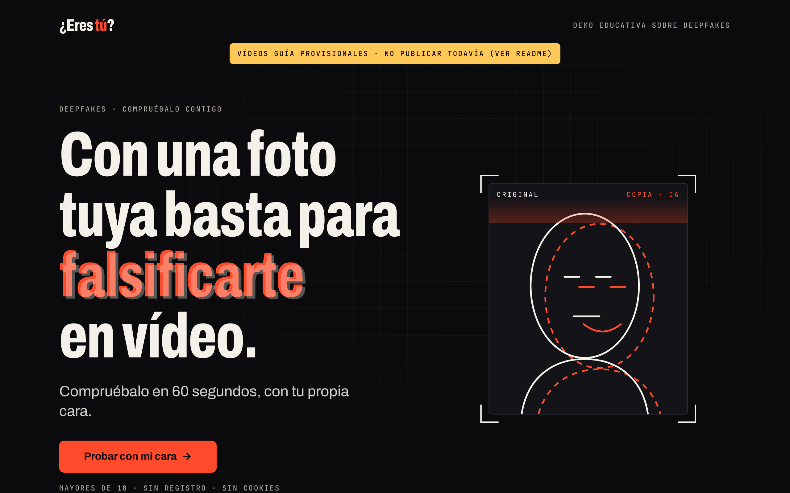
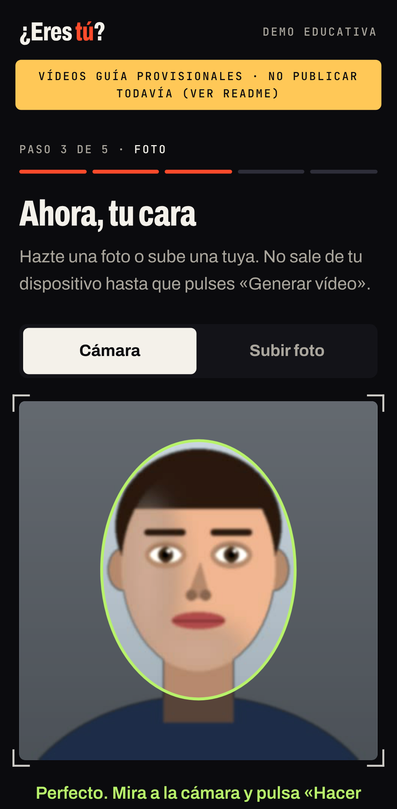
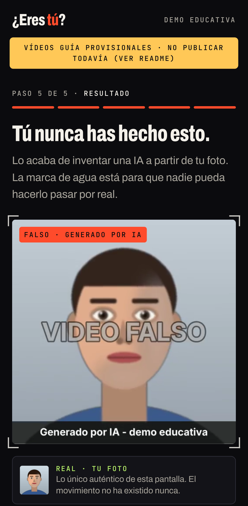

# ¿Eres tú?

**Demo web de concienciación sobre deepfakes.** El visitante se hace una foto (o sube una suya), elige una de seis animaciones y en uno o dos minutos ve un vídeo de 4 a 10 segundos de su propia cara haciendo algo que nunca ha hecho o estando en un sitio donde nunca ha estado. El vídeo lleva una marca de agua quemada y va seguido de un bloque educativo: qué acaba de pasar, cómo detectarlo y qué hacer si te ocurre.

| Portada | Foto | Resultado |
| :-: | :-: | :-: |
|  |  |  |

Lo que **no** hace: dejar escribir texto al visitante, poner palabras en su boca, conservar audio o voz, ni ofrecer la descarga del vídeo.

---

## Índice

1. [Cómo funciona](#cómo-funciona)
2. [Las seis animaciones](#las-seis-animaciones)
3. [Puesta en marcha](#puesta-en-marcha)
4. [Variables de entorno](#variables-de-entorno)
5. [Comandos disponibles](#comandos-disponibles)
6. [Arquitectura y estructura del proyecto](#arquitectura-y-estructura-del-proyecto)
7. [Cómo se genera el vídeo](#cómo-se-genera-el-vídeo)
8. [Costes](#costes)
9. [Salvaguardas](#salvaguardas)
10. [Pruebas](#pruebas)
11. [Despliegue](#despliegue)
12. [Solución de problemas](#solución-de-problemas)
13. [Limitaciones conocidas](#limitaciones-conocidas)
14. [Antes de publicar](#antes-de-publicar)
15. [Créditos](#créditos)

---

## Cómo funciona

El recorrido tiene cinco pasos:

1. **Portada.** Explica qué va a pasar y qué no se guarda.
2. **Consentimiento.** El visitante declara que la cara es la suya y acepta el tratamiento.
3. **Foto.** Con la cámara (con un óvalo guía) o subiendo una imagen si `UPLOAD_ENABLED=true`. En el navegador se detecta la cara con MediaPipe: se rechazan las fotos sin cara o con más de una. La foto se recorta a 512×512, se convierte a JPEG y se le quitan los metadatos antes de enviarla.
4. **Animación.** Elige una de las seis tarjetas, cada una con una miniatura dibujada en bucle.
5. **Resultado.** El servidor genera el vídeo con IA, le quema la marca de agua y lo entrega. Debajo aparecen los bloques educativos y un botón «Borrar mis datos ahora». El vídeo se borra solo a los 10 minutos.

Modelos usados, a través de **OpenRouter**:

| Tipo | Modelo | Cómo usa la foto |
| --- | --- | --- |
| Gestos (4) | **Grok Imagine Video 1.5 Lite** (`x-ai/grok-imagine-video-1.5-lite`) | Como **primer fotograma**: el vídeo arranca en tu foto y la anima. |
| Escenas (2) | **Grok Imagine Video** (`x-ai/grok-imagine-video`) | Como **referencia de identidad**: el vídeo arranca ya en otro lugar, sin mostrar la transformación. |

---

## Las seis animaciones

| Id | Nombre | Qué hace | Duración | Modelo |
| --- | --- | --- | :-: | --- |
| `saludo` | Saludo | Asiente dos veces y sonríe | 4 s | 1.5 Lite |
| `sonrisa` | Sonrisa | De expresión seria a sonrisa amplia | 4 s | 1.5 Lite |
| `sorpresa` | Sorpresa | Cejas arriba, boca abierta, y se relaja | 4 s | 1.5 Lite |
| `guino` | Guiño | Guiño e inclinación leve de cabeza | 5 s | 1.5 Lite |
| `teletransporte` | Teletransporte | En una calle de noche con neones y lluvia; mira alrededor asombrado | 10 s | Grok Imagine Video |
| `escenario` | Bajo los focos | En un gran escenario de concierto con focos y confeti; levanta los brazos | 10 s | Grok Imagine Video |

- La lista blanca está en `lib/animations.ts`. Es la única fuente de verdad: la usan la interfaz para pintar las tarjetas y el servidor para validar la petición.
- Las instrucciones (prompts) están en `lib/prompts.ts`, **solo en el servidor**. Todas piden que la persona no hable, y que no aparezca texto ni otras personas. Las escenas, además, piden que la escena esté presente desde el primer fotograma y que se mantengan la cara, el tono de piel, el peinado y la ropa de la foto.
- Las miniaturas (`public/previews/*.mp4`) son dibujos generados con `scripts/make-placeholders.mjs`, no resultados reales del modelo.

### Añadir o cambiar una animación

1. Añade el id y sus datos en `lib/animations.ts`: nombre, descripción, segundos, miniatura y `photoUse` (`"first_frame"` o `"reference"`).
2. Añade su instrucción en `lib/prompts.ts`. TypeScript avisa si falta alguna.
3. Genera la miniatura con `node scripts/make-placeholders.mjs <id>`, tras añadir el gesto en ese script.
4. Respeta los topes de duración:
   - Ningún vídeo puede pasar de 15 s (`MAX_VIDEO_SECONDS` en `lib/config.ts`).
   - Con `photoUse: "reference"`, el modelo de escenas admite **10 s como máximo** y responde HTTP 400 si se pide más.

---

## Puesta en marcha

### Requisitos

- **Node.js 22.12 o posterior.**
- **ffmpeg** con el filtro `drawtext` y el codificador `libx264`:
  - Windows: `winget install --id Gyan.FFmpeg -e` (después abre una terminal nueva).
  - macOS: `brew install ffmpeg`.
  - Debian/Ubuntu: `sudo apt install ffmpeg`.

### Instalación

```bash
git clone <url-del-repositorio>
cd eres-tu
npm install
```

### Opción A: modo simulado (gratis, sin clave)

```bash
npm run demo:simulada
```

Abre `http://localhost:3000`. Funciona todo de verdad (cámara, detector de caras, recorte, límites, marca de agua y borrado) **excepto el modelo**: el vídeo final es siempre una cara dibujada de muestra. La web lo avisa arriba en verde. En este modo la foto no sale de tu ordenador.

### Opción B: modelo real (gasta saldo)

1. Crea una clave en <https://openrouter.ai/keys>, añade crédito y **ponle un límite de gasto**.
2. Copia la plantilla de configuración:
   ```bash
   cp .env.example .env.local        # en PowerShell: Copy-Item .env.example .env.local
   ```
3. Abre `.env.local` y pega la clave en `OPENROUTER_API_KEY=`.
4. Arranca:
   ```bash
   npm run dev
   ```
5. Abre `http://localhost:3000`.

> `.env.local` contiene tu clave y **no se sube al repositorio**: está en `.gitignore`. Solo se versiona `.env.example`, sin secretos.

### Producción en local

```bash
npm run build
npm start
```

---

## Variables de entorno

Se leen en cada petición, no al compilar, así que la misma imagen sirve para cualquier entorno.

| Variable | Por defecto | Para qué |
| --- | --- | --- |
| `OPENROUTER_API_KEY` | — | Clave de OpenRouter. Solo en el servidor; el navegador nunca la ve. |
| `OPENROUTER_VIDEO_MODEL` | `x-ai/grok-imagine-video-1.5-lite` | Modelo de los gestos (foto como primer fotograma). |
| `OPENROUTER_SCENE_VIDEO_MODEL` | `x-ai/grok-imagine-video` | Modelo de las escenas (foto como referencia, `input_references`). |
| `DEMO_ENABLED` | apagada | Interruptor general. **Solo `true`** enciende la demo. |
| `UPLOAD_ENABLED` | solo cámara | **Solo `true`** permite subir fotos además de usar la cámara. |
| `MAX_PER_IP_PER_DAY` | `3` | Vídeos por IP y día (UTC). |
| `MAX_GLOBAL_PER_DAY` | `200` | Vídeos totales al día: es el techo de gasto. |
| `GENERATION_TIMEOUT_SECONDS` | `280` | Espera máxima al modelo (de 5 a 280). |
| `COST_PER_VIDEO_EUR` | — | Coste por vídeo que se enseña en el resultado. Si está vacío, se muestra «céntimos». |
| `ORG_NAME`, `CONTACT_EMAIL` | — | Responsable y contacto que aparecen en `/privacidad`. |
| `CLIENT_IP_HEADER` | automática | Cabecera de la que fiarse para la IP (p. ej. `cf-connecting-ip` detrás de Cloudflare). |
| `FFMPEG_PATH` | `ffmpeg` | Ruta de ffmpeg si no está en el `PATH`. |
| `WATERMARK_FONT_PATH` | `fonts/Inter-Bold.ttf` | Fuente de la marca de agua. |

Los dos interruptores fallan hacia lo seguro: si la variable falta, la demo queda en pausa y la subida, desactivada.

---

## Comandos disponibles

| Comando | Qué hace |
| --- | --- |
| `npm run dev` | Servidor de desarrollo con el modelo real (lee `.env.local`). |
| `npm run demo:simulada` | Servidor con un OpenRouter simulado: gratis y sin clave. |
| `npm run build` | Compila para producción (salida *standalone* en `.next/standalone`). |
| `npm start` | Arranca la versión compilada. |
| `npm run lint` | ESLint. |
| `npm run typecheck` | Genera los tipos de rutas y ejecuta `tsc --noEmit`. |
| `npm test` | Pruebas unitarias y de API (Vitest). |
| `npm run test:e2e` | Pruebas de navegador (Playwright). |
| `npm run test:all` | Todo lo anterior seguido, incluida la compilación. |
| `npm run preflight` | Revisa la configuración antes de publicar. |
| `node scripts/make-placeholders.mjs [ids…]` | Regenera las miniaturas (todas o solo las indicadas). |

---

## Arquitectura y estructura del proyecto

Aplicación **Next.js 16** (App Router) con **React 19** y **Tailwind CSS 4**. No tiene base de datos: los contadores y los vídeos temporales viven en la memoria del proceso.

```
app/
  page.tsx                 Página principal (asistente de cinco pasos)
  privacidad/page.tsx      Aviso de privacidad
  api/generate/route.ts    POST: valida la foto, aplica límites, genera y marca el vídeo
  api/video/[id]/route.ts  GET/DELETE: sirve o borra el vídeo temporal
  api/health/route.ts      Comprobación de salud para la plataforma
components/                Pasos del asistente (StepIntro, StepConsent, StepPhoto,
                           StepAnimation, StepResult), bloques educativos y UI común
lib/
  animations.ts            Lista blanca de animaciones (compartida cliente/servidor)
  prompts.ts               Instrucciones fijas del modelo (solo servidor)
  openrouter.ts            Cliente de la API de vídeo de OpenRouter
  watermark.ts             Marca de agua con ffmpeg
  config.ts                Lectura y validación de variables de entorno
  rateLimit.ts             Límites por IP y globales (en memoria)
  tempStore.ts             Almacén temporal de vídeos con caducidad
  jpeg.ts, photo.ts        Validación y limpieza de la foto
  faceDetection.ts         Detector de caras (MediaPipe, en el navegador)
  clientIp.ts              IP del visitante según la plataforma
  errors.ts, texts.ts      Mensajes y textos de la interfaz
scripts/                   Demo simulada, miniaturas, preflight y pasos de compilación
tests/                     Pruebas unitarias, de navegador, imágenes de prueba y el OpenRouter simulado
public/previews/           Miniaturas de las animaciones
fonts/                     Fuente de la marca de agua
Dockerfile, fly.toml, railway.json   Despliegue
```

Separación de responsabilidades:

- **Interfaz** (`components/`): solo captura, prepara la foto y muestra el resultado.
- **Orquestación** (`app/api/generate`): valida, aplica límites, llama al modelo, marca el vídeo y lo guarda.
- **Infraestructura** (`lib/openrouter.ts`, `lib/watermark.ts`): transporte HTTP y ffmpeg. Convierten las respuestas externas en errores tipados (`rejected`, `busy`, `unavailable`).

---

## Cómo se genera el vídeo

`lib/openrouter.ts` usa la API asíncrona de vídeo de OpenRouter:

1. `POST /api/v1/videos` con el modelo, la instrucción, la duración, `resolution: "480p"`, `aspect_ratio: "1:1"` y la foto en base64:
   - gestos: en `frame_images` con `frame_type: "first_frame"`;
   - escenas: en `input_references`, como referencia de identidad.
2. Consulta del trabajo cada 2 segundos (`polling_url`) hasta que pasa a `completed`, `failed`, `cancelled` o `expired`.
3. Descarga del vídeo, marca de agua con ffmpeg y entrega al navegador por una URL temporal propia. La URL del proveedor nunca llega al navegador.

### Clasificación de errores

| Código interno | Cuándo | Lo que ve el visitante | ¿Cuenta en el límite? |
| --- | --- | --- | --- |
| `rejected` | El filtro de contenido rechaza la foto (trabajo `failed`, o HTTP 400/413/422 por la imagen) | «El modelo no ha podido usar esta foto…», con consejos | Sí |
| `unavailable` | Clave, saldo, modelo o un **parámetro** no admitido (p. ej. «Duration 12s exceeds the maximum…») | «La demo no está disponible… este intento no cuenta» | No |
| `busy` | Tiempo agotado, 429, 5xx o fallo de red | «El servicio va lento… este intento no cuenta» | No |

El motivo exacto queda en la terminal del servidor, en líneas `[modelo]` y `[generate]`, sin datos de la imagen ni URLs.

### Marca de agua

`lib/watermark.ts` aplica con ffmpeg:

- una franja inferior opaca con «Generado por IA - demo educativa»;
- elimina el audio (`-an`) y los metadatos de origen;
- añade el metadato `comment="AI-generated. Educational deepfake demo."`;
- corta a `MAX_VIDEO_SECONDS` (15 s).

Es el único camino por el que un vídeo llega al almacén temporal: si ffmpeg falla, no se guarda nada y la versión sin marca se descarta.

---

## Costes

Precios publicados en OpenRouter a 480p (pueden cambiar; revísalos):

| Tipo | Precio | Coste aproximado por vídeo |
| --- | --- | --- |
| Gestos (1.5 Lite) | 0,02 $/s + 0,01 $ por imagen | 0,09–0,11 $ |
| Escenas (Grok Imagine Video) | 0,05 $/s + 0,002 $ por imagen | ~0,50 $ |

Techo de gasto diario: `MAX_GLOBAL_PER_DAY` × coste por vídeo. Con 200 vídeos, entre ~20 $ (solo gestos) y ~100 $ (solo escenas). **Pon siempre un límite de crédito a la clave en OpenRouter.**

---

## Salvaguardas

| Salvaguarda | Cómo está implementada |
| --- | --- |
| Solo la propia cara | Casilla de consentimiento y aviso junto al botón de subida. **No es verificable técnicamente.** |
| Una sola persona | Detección facial en el navegador: se rechazan las fotos con 0 o más de 1 cara. |
| Sin palabras en boca de nadie | Instrucciones fijas en el servidor, sin texto del visitante, y audio siempre eliminado. |
| Vídeo siempre marcado | La marca se quema en el servidor. La URL del servicio de IA nunca llega al navegador. |
| Sin conservación por nuestra parte | Vídeo borrado a los 10 minutos, al pulsar «Borrar mis datos ahora», al generar otro o al cerrar la página. La foto no se guarda en disco. |
| Límite de abuso | 3 vídeos por IP y día, 200 globales al día y `DEMO_ENABLED` como apagado. |
| Control de gasto | Tope global de vídeos y límite de crédito en la clave. |
| Entrada válida | El servidor comprueba los bytes: JPEG real, 512×512, ≤ 2 MB, sin metadatos. |
| Secretos | La clave solo existe en el servidor y en `.env.local`, que no se versiona. |

---

## Pruebas

```bash
npx playwright install chromium   # solo la primera vez
npm run test:all
```

Ejecuta, por este orden:

- el linter;
- la comprobación de tipos;
- las pruebas unitarias y de API;
- la compilación;
- las pruebas de navegador.

Ninguna necesita clave ni gasta dinero: usan un OpenRouter simulado (`tests/support/mock-modelo.mjs`) que responde con el mismo protocolo. Las imágenes de prueba (`tests/fixtures`) son dibujos generados por programa; no aparece ninguna persona real.

---

## Despliegue

Un contenedor con Node.js y ffmpeg, **una sola instancia, siempre encendida**: los límites y los vídeos temporales viven en memoria.

### Docker

```bash
docker build -t eres-tu .
docker run --rm -p 3000:3000 --env-file .env.local eres-tu
```

### Fly.io

```bash
fly launch --no-deploy --copy-config
fly secrets set OPENROUTER_API_KEY=... ORG_NAME="Tu organización" CONTACT_EMAIL=...
fly deploy
fly scale count 1
```

### Railway

`railway.json` ya configura el Dockerfile, una réplica y la comprobación de salud `/api/health`. Define las variables de entorno en el panel, nunca en el repositorio.

Para apagar la demo sin desplegar, pon `DEMO_ENABLED=false`.

---

## Solución de problemas

| Síntoma | Causa y solución |
| --- | --- |
| «Demo en pausa» | Falta `DEMO_ENABLED=true` en `.env.local`. |
| «Has llegado al límite» | Se han gastado los vídeos del día para tu IP: sube `MAX_PER_IP_PER_DAY`. Los contadores se reinician al reiniciar el servidor o a medianoche UTC. |
| «No se encuentra ffmpeg» | Instálalo y abre una terminal nueva, o define `FFMPEG_PATH`. |
| «La demo no está disponible» | Mira la línea `[modelo]` en la terminal: clave vacía o incorrecta, sin saldo, modelo inexistente o un parámetro no admitido. |
| «El modelo no ha podido usar esta foto» | El filtro de contenido del modelo rechazó la imagen. Prueba con otra foto de frente y con buena luz. |
| La cámara no se abre | El navegador necesita permiso. En otro dispositivo de la red hace falta HTTPS; `localhost` sí funciona. |
| La generación tarda mucho | Lo normal es de 30 s a 2 minutos; las escenas tardan más. El límite es `GENERATION_TIMEOUT_SECONDS`. |

---

## Limitaciones conocidas

- **Nada impide técnicamente usar la foto de otra persona.** La app depende de la declaración del visitante.
- **El resultado no es determinista.** El modelo interpreta la instrucción: el gesto puede variar, la cara o el fondo pueden cambiar ligeramente y no hay garantía absoluta de que respete «no hablar» (por eso el audio se elimina siempre).
- **En las escenas, el parecido puede ser menor** que en los gestos, porque el vídeo no parte de la foto exacta sino de una referencia.
- **No controlamos qué hacen OpenRouter y xAI con la foto.** El aviso de privacidad lo dice así. Revisa sus políticas antes de publicar.
- **No hay verificación de edad.** Con menores, valora `UPLOAD_ENABLED=false`.
- **El límite por IP no distingue personas.** En un aula o evento todos comparten IP.
- **El límite cuenta vídeos, no dinero:** una escena cuenta igual que un gesto aunque cueste unas cinco veces más.
- **Los contadores viven en memoria:** hace falta una sola instancia.
- **Las miniaturas son dibujos** que ilustran la animación, no ejemplos reales del modelo.

---

## Antes de publicar

`npm run preflight` comprueba lo que puede comprobar una máquina. Lo demás:

- [ ] Clave de OpenRouter con **límite de crédito**.
- [ ] Generaciones reales revisadas a ojo con varias caras, en las seis animaciones.
- [ ] `ORG_NAME` y `CONTACT_EMAIL` definidos.
- [ ] Políticas de privacidad y de uso de OpenRouter y xAI revisadas, sobre todo en lo relativo a imágenes de personas.
- [ ] Texto de `/privacidad` revisado por alguien con conocimientos legales.
- [ ] Probado en teléfonos reales.

---

## Créditos

Fuentes, detector de caras y servicios de terceros, con sus licencias, en [AVISOS.md](AVISOS.md).
